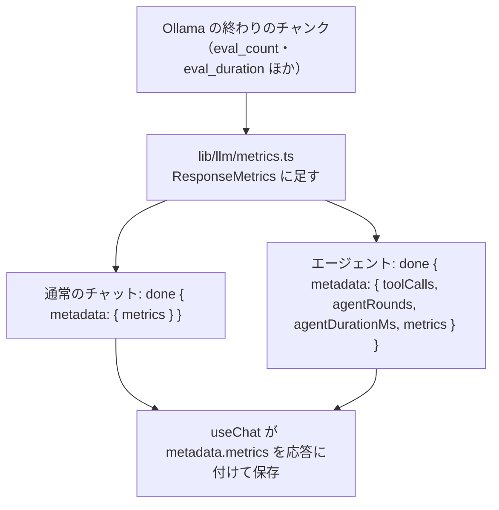

# トークン数・生成速度の表示 設計書

> 最終更新: 2026-10-31

Ollama の応答の終わりに届くメトリクスを集め、応答ごとにトークン数・生成速度を表示するための設計（#31 の Phase A・B。サブ issue #204）。会話ごとの累計・モデルの比較（#31 Phase C のダッシュボード）は含めない。

## 目次

- [背景](#背景)
- [前提の調査](#前提の調査)
- [範囲](#範囲)
- [決めること（レビューの論点）](#決めることレビューの論点)
- [集める値](#集める値)
- [ストリームでの受け渡し](#ストリームでの受け渡し)
- [保存と読み込み](#保存と読み込み)
- [表示](#表示)
- [ファイル構成](#ファイル構成)
- [テスト](#テスト)
- [やらないこと](#やらないこと)

## 背景

応答が遅いとき、モデルの読み込みに時間がかかったのか、プロンプトが長いのか、生成そのものが遅いのかが画面から分からない。エージェントの応答には「N ラウンド・X.Xs」が出るが、トークン数は出ない。Ollama は応答の終わりのチャンク（`done: true`）にトークン数と所要時間を載せているので、これを集めて出す。

## 前提の調査

Ollama 0.40.5 で確かめた（2026-10-31）。

| 項目 | 結果 |
|---|---|
| 終わりのチャンクの値 | `prompt_eval_count`・`prompt_eval_cached_count`・`prompt_eval_duration`・`eval_count`・`eval_duration`・`load_duration`・`total_duration`・`done_reason`。時間はナノ秒 |
| キャッシュ | `prompt_eval_count` はキャッシュの分も含めたプロンプト全体のトークン数。同じプロンプトを続けて送ると、44 トークン中 43 トークンが `prompt_eval_cached_count` になり、`prompt_eval_duration` は 57ms → 4.5ms になった |
| 思考のトークン | `eval_count` に入る（`qwen3.8:27b` で、思考 230 文字・本文「2」の応答が 86 トークン）。本文だけのトークン数は分からない |
| モデルの読み込み | `load_duration` に入る（`qwen3.8:27b` で 2.8 秒。読み込み済みなら数 ms） |
| 停止した応答 | 終わりのチャンクが届かないため、値は無い |

今のストリーム:

- 通常のチャット（`enableTools` なし）の `/api/chat` は、本文の文字列だけを `text/event-stream` で流している。終わりのチャンクの値は捨てている。
- エージェントの `/api/chat` は `AgentStreamEvent` の NDJSON で、`done` に `metadata`（ツールの記録・ラウンド数・所要時間）を載せている。
- 画面（`useChat`）は `Content-Type` が `application/x-ndjson` なら NDJSON として、そうでなければ文字列として読む。

## 範囲

| 含める | 含めない（[やらないこと](#やらないこと)） |
|---|---|
| 通常のチャット・エージェントの応答のトークン数・所要時間を集める | タイトルの生成（`chatOnce`）のトークン数 |
| 応答の `metadata` に保存し、開き直しても出す | 会話ごとの累計・モデルの比較・グラフ（#31 Phase C） |
| 応答の下に 1 行の要約、押すと内訳 | 停止した応答の途中までの値 |

## 決めること（レビューの論点）

| 論点 | 推奨 | 他の案 | 理由 |
|---|---|---|---|
| 範囲 | **応答ごとの表示まで**（#31 の Phase A・B と、そのテスト）。ダッシュボードは別の issue | ダッシュボードまで一度に入れる | 応答ごとの値が溜まってから、何を比べたいかを決める。保存にモデル名を入れておき、後から集計できるようにする |
| 通常のチャットの受け渡し | **NDJSON にする**（`text_delta` と `done`。エージェントと同じイベント） | 文字列の後ろに区切りを入れて値を付ける・別の API で取りに行く | 画面はすでに NDJSON を読めるため、通常のチャットもそこに載せれば値の受け渡しが 1 つで済む。区切りは本文に同じ文字列が出ると壊れる。文字列で返す応答（E2E の差し替え）も、今までどおり読める |
| 保存先 | **メッセージの `metadata.metrics`**（マイグレーションなし） | 専用のテーブル | 応答と 1 対 1 で、応答の置き換え（再生成）・削除にそのまま付いていく。集計が要るようになったら、そのときに考える |
| エージェントの値 | **ラウンドの合計**。入力は「読んだトークンの合計」と「一番大きかった文脈」を分けて持つ | 最後のラウンドだけ | 時間は合計しないと応答の重さが分からない。入力の合計はラウンドごとに会話全体を読み直すため大きくなるので、文脈の大きさ（モデルの上限に近いか）は最大値で別に見せる |
| 停止した応答 | **出さない** | 終わったラウンドの分だけ出す | 通常のチャットは値が届かない。エージェントだけ途中の値を出すと、何の合計か分かりにくい |
| 表示 | **応答の下の行に「312 トークン・42.1 トークン/秒」**。押すと内訳を開く | 常に内訳を出す・ホバーで出す | 毎回目に入るのは要約だけでよい。ホバーはタッチ端末で開けない |

## 集める値

Ollama の終わりのチャンクを、応答 1 回分の値（`ResponseMetrics`）にまとめる。時間はミリ秒に直す。

```ts
type ResponseMetrics = {
  model: string;              // 応答したモデル（終わりのチャンクの `model`）
  calls: number;              // 合計した Ollama の問い合わせの数（通常のチャットは 1、エージェントはラウンドの数）
  promptTokens: number;       // 入力のトークン数（prompt_eval_count の合計。キャッシュの分を含む）
  promptCachedTokens: number; // そのうちキャッシュの分（prompt_eval_cached_count の合計。無ければ 0）
  maxPromptTokens: number;    // 一番大きかった 1 回の入力（文脈の大きさ）
  promptDurationMs: number;   // 入力の処理の時間（prompt_eval_duration の合計）
  outputTokens: number;       // 出力のトークン数（eval_count の合計。思考を含む）
  outputDurationMs: number;   // 出力の生成の時間（eval_duration の合計）
  loadDurationMs: number;     // モデルの読み込みの時間（load_duration の合計）
  totalDurationMs: number;    // Ollama の中の時間（total_duration の合計）
};
```

- 生成の速さ（トークン/秒）は保存せず、表示のときに `outputTokens / (outputDurationMs / 1000)` で出す。
- 終わりのチャンクに `eval_count` か `eval_duration` が無い・数でないときは、その問い合わせを合計に入れない。1 つも入らなければ値を持たない。
- エージェントの最大ラウンドに達した後の最終回答の問い合わせも合計に入れる（`calls` と `agentRounds` は同じ数になる）。
- 集めるのはサーバー（`lib/llm/metrics.ts`）。通常のチャットの route とエージェントのループが、終わりのチャンクを受けるたびに足す。

## ストリームでの受け渡し



- **通常のチャット**: `/api/chat` を `application/x-ndjson` にし、本文は `text_delta`、終わりに `done`（`metadata: { metrics }`）を送る。通常のチャットは思考を今も出していないので、`thinking` は送らない（今と同じ）。
- **エージェント**: `done` の `metadata` に `metrics` を足す。
- `done` の `metadata.toolCalls` は今は必ずある。通常のチャットでは持たないので省略できるようにする（画面は通常のチャットの応答に、ツールの記録・ラウンド数を足さない）。
- 画面が文字列として読む経路（`Content-Type` が NDJSON でない応答）は残す。値は無いので出さない。

## 保存と読み込み

- 画面は `done` の `metadata.metrics` を応答の `metadata` に入れ、今までどおりメッセージの保存・置き換えの API で送る。API と DB は変えない（`metadata` は任意の JSON）。
- 通常のチャットの応答は今は `metadata` が `null` だが、値があれば `{ metrics }` を持つ。
- 読み込み（`lib/chat/message-metadata.ts` の `parseMessageMetadata`。ほかの項目の検証と同じ場所）で形を確かめる。`model` は空でない文字列、数はすべて 0 以上の有限の数（`calls` は 1 以上の整数）。合わなければ `metrics` だけを捨てる（ほかの項目は読む）。
- 書き出し: JSON は `metadata` をそのまま含む。Markdown には入れない。

## 表示

応答の下の行（コピー・保存・再生成・時刻の並び）の前に、要約を出す。エージェントの応答は、今の「N ラウンド・X.Xs」の行に並べる。

```
312 トークン · 42.1 トークン/秒            ← 押すと内訳を開く
┌──────────────────────────────────────┐
│ モデル            qwen3.8:27b          │
│ 出力              312 トークン（思考を含む）・7.4 秒 │
│ 入力              1,204 トークン（キャッシュ 1,180）・0.3 秒 │
│ 最大の文脈        1,204 トークン        │  ← エージェントで calls が 2 以上のときだけ
│ モデルの読み込み  2.8 秒                │  ← 0.5 秒以上のときだけ
│ Ollama の中の時間 10.5 秒               │
└──────────────────────────────────────┘
```

- 数は 3 桁ごとに区切る。時間は 0.1 秒単位、速さは 0.1 トークン/秒単位。
- 生成の時間が 0（1 トークンだけ等）のときは、速さを出さない。
- 要約はボタン（`aria-expanded`）にし、内訳は応答の下に開く（モーダルにしない）。
- 値の無い応答（停止した・この機能より前に保存した・文字列で返した）には何も出さない。

## ファイル構成

```
front/src/
├── lib/llm/metrics.ts            # 終わりのチャンクから ResponseMetrics への変換・合計（サーバー）
├── lib/chat/response-metrics.ts  # 表示の文字列（要約・内訳・速さ）
├── types/chat/metrics.ts         # ResponseMetrics（サーバーの集計・保存・表示で共有）
├── types/chat/message.ts         # metadata.metrics を足す
├── lib/llm/ollama.ts             # OllamaStreamChunk に終わりのチャンクの値を足す
├── app/api/chat/route.ts         # 通常のチャットを NDJSON にし、done に metrics を載せる
├── lib/agent/agent.ts            # ラウンドごとに足し、done に載せる
├── lib/agent/tools/types.ts      # done の metadata（toolCalls を省略可に・metrics）
├── lib/chat/message-metadata.ts  # metrics の組み立て・保存済みの値の検証
├── hooks/chat/useChat.ts         # 通常のチャットの NDJSON・done の metrics を応答に付ける
└── components/features/chat/molecules/ResponseMetrics.tsx  # 要約のボタンと内訳
```

## テスト

| 層 | 対象 |
|---|---|
| UT | 終わりのチャンクの変換（値が欠けた・数でない・キャッシュが無い）・合計（最大の文脈・`calls`）・表示の文字列（区切り・0.1 秒・速さ・時間 0）・保存済みの値の検証（負・文字列・`calls` 0・`model` 空） |
| IT | 通常のチャットが NDJSON で `text_delta` と `done`（`metrics`）を返す・エージェントの `done` にラウンドの合計が載る・Ollama が値を返さないときは `metrics` を持たない・`metrics` 付きの応答を保存して読み込める |
| E2E | 保存した応答の下に要約が出て、押すと内訳が開閉する・エージェントの内訳（API で保存した会話を開く形で、軽量モデル・CI でも動く）。値の無い応答・生成の時間が 0 の応答・形の合わない値。実際に生成した通常のチャットの応答に出て、同じ値を保存する（生成の完了を待つため CI ではスキップ。`chat-streaming.spec.ts` と同じ扱い） |

文字列で `/api/chat` を差し替える既存の E2E（図・再生成・停止等）は、文字列の経路が残るので今のまま動く。

## やらないこと

- 会話ごとの累計・モデルの比較・グラフ（#31 Phase C。応答ごとの値が溜まってから別の issue で決める）
- タイトルの生成のトークン数
- 停止した応答の途中までの値
- 本文だけのトークン数（思考と分けて数える手段が Ollama に無い）
- コンテキストの上限に対する割合（モデルごとの上限を取る仕組みが無い）
