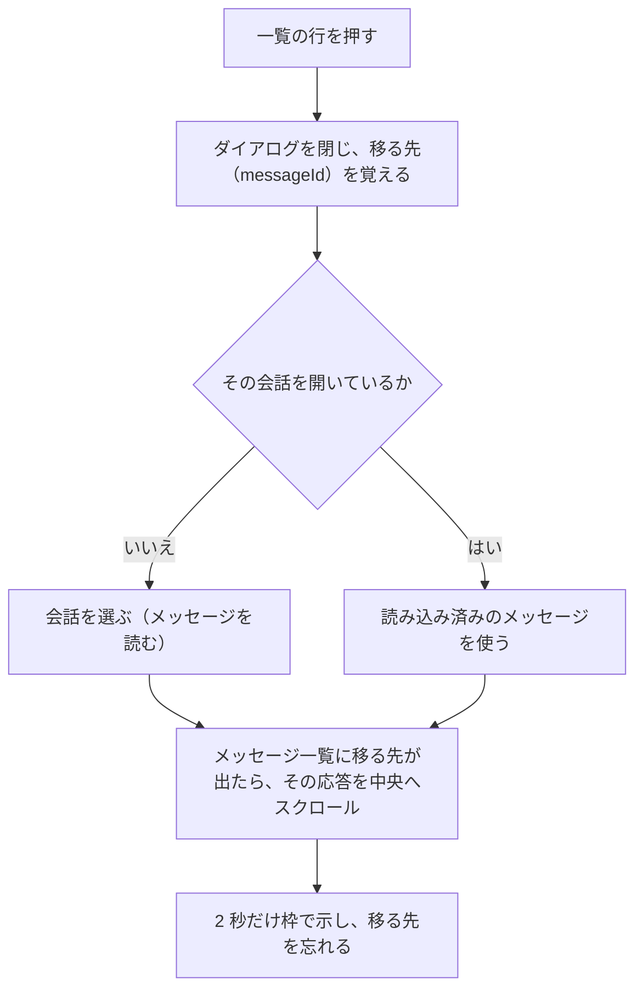

# 応答のブックマーク 設計書

> 最終更新: 2026-10-31

役に立った応答（assistant のメッセージ）にブックマークを付け、会話をまたいだ一覧から探して、元の会話のその応答へ戻れるようにするための設計（#30 の Phase A・B。サブ issue #211）。タグとタグでの絞り込みは含めない。

## 目次

- [背景](#背景)
- [会話の検索との違い](#会話の検索との違い)
- [範囲](#範囲)
- [決めること（レビューの論点）](#決めることレビューの論点)
- [データ](#データ)
- [API](#api)
- [応答のブックマークのボタン](#応答のブックマークのボタン)
- [ブックマークの一覧](#ブックマークの一覧)
- [元の応答へ移る](#元の応答へ移る)
- [ファイル構成](#ファイル構成)
- [テスト](#テスト)
- [やらないこと](#やらないこと)

## 背景

うまく書けたコード・手順・説明の応答を後でもう一度読みたいとき、今は「どの会話だったか」を覚えておき、会話の検索（#11）で思い出せる語を打ち、会話を開いてから長い会話をスクロールして探している。応答に印を付けておけば、一覧から直接その応答へ戻れる。

## 会話の検索との違い

| | 会話の検索（#11） | ブックマーク |
|---|---|---|
| 探す対象 | すべての会話（タイトル・本文） | 印を付けた応答だけ（メモ・応答の本文・会話のタイトル） |
| 結果を押すと | その会話を開く（一番下を見せる） | その会話を開き、**その応答まで移って**枠で示す |
| 残すもの | なし | 応答への印と、任意のメモ |
| 置き場所 | サイドバーの履歴の上 | サイドバーの下のボタンから開くダイアログ |

## 範囲

| 含める | 含めない（[やらないこと](#やらないこと)） |
|---|---|
| ブックマークの保存（DB）と API | タグ・タグでの絞り込み |
| 応答の下のボタンで付ける・外す | user のメッセージへのブックマーク |
| 会話をまたいだ一覧（新しい順・キーワード検索・さらに表示） | ブックマークの並べ替え・フォルダ |
| 一覧でのメモの編集・ブックマークの削除 | ブックマークの書き出し（JSON・Markdown） |
| 一覧から元の会話の応答へ移る | 会話の検索の結果から、一致したメッセージへ移る |

## 決めること（レビューの論点）

| 論点 | 推奨 | 他の案 | 理由 |
|---|---|---|---|
| 範囲 | **Phase A・B まで**（保存・API・ボタン・一覧・移る、とそのテスト）。タグは入れない | issue の案のとおりタグと絞り込みまで | 使ってみて、キーワード検索とメモで足りなければタグを足す。プロンプトテンプレート（#28）のカテゴリと同じ扱い。後から足しても今のブックマークはそのまま使える |
| 付けられるもの | **保存済みの assistant の応答だけ** | user のメッセージにも付ける | 後で読み返したいのは答えの方。質問は一覧の行に出さなくても、移った先で応答の上に見える |
| 保存先 | **`Bookmark` のテーブル**（`messageId` を一意にし、メッセージの削除でカスケード削除） | `Message` に `bookmarkedAt`・`bookmarkNote` の列を足す | メッセージの行を太らせず、ブックマークだけを新しい順に引ける。後でタグを足すときも `Bookmark` の側だけで済む。会話を消せば Conversation → Message → Bookmark と消え、取り残しが出ない |
| 付けるときの操作 | **押すだけで付く**（メモは一覧で後から書く） | 押すとメモ・タグを書く小窓を出す（issue の案） | 読んでいる途中に付けたいので、手数を 1 回にする。メモを書かずに付けることの方が多いはず |
| 一覧の場所 | **ダイアログ**（共通の `Modal`）。入口はサイドバーの下の設定の隣のボタン | サイドバーの「History / Bookmarks」のタブ | 抜粋とメモを読むには、サイドバーの幅（ドロワーではさらに狭い）では足りない。メモの編集もダイアログの方が書きやすい |
| 一覧の検索 | **キーワード**（空白区切りの AND・大文字小文字を区別しない部分一致）。対象はメモ・応答の本文・会話のタイトル | 手元で絞り込む（全件を読んでから） | 会話の検索と同じ書き方・同じ解釈にそろえる。件数に上限を設けないので、全件を読ませない |
| 一覧の並び | **付けた日時の新しい順**、20 件ずつ「さらに表示」 | 会話ごとにまとめる | 最近付けたものほど読み返す。会話の検索の結果と同じ件数・同じ続きの読み方 |
| 件数の上限 | **設けない**（一覧はページ分けして読む） | 100 件まで（プロンプトテンプレートと同じ） | 一覧をページ分けするので、件数が増えても困らない。上限があると、古いものを消さないと付けられなくなる |
| メモ | **任意・500 文字まで**。空白だけなら「メモなし」（`null`）にする | 必須にする | 書かずに付ける方が多い。一覧の行で読める長さに抑える |
| 外すときの確認 | **応答の下のボタンは押すだけで外す**（付けるのと対にする）。**一覧の「外す」は行の中で 2 段階** | どちらも確認なし・どちらも確認あり | 応答の下では、付けた直後の押し間違いをすぐ押し直せる。一覧では、どの行かを見て押すので、メモを失う押し間違いを防ぐ（プロンプトテンプレートの削除と同じ） |
| 再生成した応答 | **置き換えを保存したときに、そのブックマークを外す**（同じトランザクション） | 残す（新しい本文に印が付いたままになる） | 印を付けたのは前の本文。新しい本文に印が残ると、一覧で読んだ内容と移った先が食い違う。再生成ボタンの出る応答（最後の応答）に限られる |
| 移ったときの見せ方 | **その応答を画面の中央までスクロールし、2 秒だけ枠で示す** | 一番上に合わせる・枠を出したままにする | 前後（質問・次のやり取り）も見えた方がよい。枠を残すと、読んでいる間ずっと目に入る |

## データ

```prisma
// 応答（assistant のメッセージ）のブックマーク（#30）。1 つの応答に 1 つまで
model Bookmark {
  id        String   @id @default(uuid())
  messageId String   @unique
  message   Message  @relation(fields: [messageId], references: [id], onDelete: Cascade)
  note      String? // メモ。最大 MAX_BOOKMARK_NOTE_LENGTH 文字。null はメモなし
  createdAt DateTime @default(now())
  updatedAt DateTime @updatedAt
}

model Message {
  // ...今の列はそのまま
  bookmark Bookmark?
}
```

- `messageId` の一意制約で、1 つの応答に 2 つ付かないようにする。一覧の並び（`createdAt` の新しい順）のために索引は足さない（個人の利用で数千件までなら、並べ替えの費用は小さい。遅くなったら足す）。
- user のメッセージに付けさせないことは、DB ではなく API で検証する（`role` は文字列の列で、DB の制約にしにくい）。
- 上限値は `lib/shared/validation.ts` に足し、ダイアログと API が同じ定数を使う（`error-handling.md`）。

| 定数 | 値 | 根拠 |
|---|---|---|
| `MAX_BOOKMARK_NOTE_LENGTH` | 500 | 一覧の行で読み切れる長さ |
| （検索のキーワード） | `MAX_SEARCH_QUERY_LENGTH` | 会話の検索と同じ |

## API

| メソッド | パス | 用途 | 成功 | 失敗 |
|---|---|---|---|---|
| GET | `/api/bookmarks?q=&offset=` | 一覧（付けた日時の新しい順・20 件ずつ）。`q` を付けるとキーワードで絞り込む | 200 `{ bookmarks: BookmarkListItem[], hasMore }` | 400（`q` が長すぎる・語が多すぎる、`offset` が 0 以上の整数でない）・500 |
| POST | `/api/bookmarks` | 付ける（`{ messageId }`） | 201 作ったブックマーク | 400（ボディ・ID の形・user のメッセージ）・404（メッセージが無い）・409（もう付いている）・500 |
| PATCH | `/api/bookmarks/[id]` | メモを書き換える（`{ note: string \| null }`） | 200 書き換えたブックマーク | 400（ID の形・ボディ・長さ）・404・500 |
| DELETE | `/api/bookmarks/[id]` | 外す | 200 `{ success: true }` | 400（ID の形）・404・500 |

`GET /api/conversations/[id]/messages` の各メッセージに、付いているブックマークの ID（`bookmark: { id } | null`）を足す。会話を開いたときに、どの応答に印が付いているかを 1 回の取得で分かるようにする。

`PUT /api/conversations/[id]/messages/[messageId]`（再生成の置き換え）は、同じトランザクションでその応答のブックマークを消す。

一覧の 1 件（`BookmarkListItem`）:

| フィールド | 内容 |
|---|---|
| `id` | ブックマークの ID |
| `note` | メモ（無ければ `null`） |
| `createdAt` | 付けた日時（ISO 8601） |
| `messageId` | 応答の ID（移る先） |
| `conversationId` | 会話の ID（開く会話） |
| `conversationTitle` | 会話のタイトル |
| `snippet` | 応答の抜粋（`lib/bookmark/snippet.ts` の `buildBookmarkSnippet`）。キーワードがあれば一致した箇所の前後（`buildSnippet`）、無ければ（または本文に一致しなければ）先頭から 120 文字（サロゲートペアを分断しない）。改行・連続する空白は 1 つの空白にまとめる |

- 検索の解釈は会話の検索（`lib/conversation/search.ts`）の `parseSearchQuery`・`escapeLikePattern`・`buildSnippet` を使い回す。`q` が空のときは絞り込まずに全件を新しい順に返す（会話の検索は `q` を必須にしているため、`parseSearchQuery` に空の `q` を受け付ける `allowEmpty` を足した。`offset` と語の数の検証を二重に持たないため）。
- 条件は「語のすべてが、メモ・応答の本文・会話のタイトルのどれかに含まれる」（語ごとに OR、語どうしは AND）。思考過程・ツールの結果（`metadata`）は対象外（会話の検索と同じ）。
- 並びは `createdAt` の新しい順、同じなら `id` の順（ページの境目で重複・抜けを出さない）。
- ボディの検証は `lib/server/request-body.ts` に `parseCreateBookmarkBody`・`parseBookmarkNoteBody` を足す。DB に触る前に検証する（`error-handling.md`）。
- もう付いているときは、事前に確かめず一意制約の違反（`P2002`）を `isUniqueConstraintError()` で 409 にする（`api.md`）。
- user のメッセージは 400（「ブックマークできるのは応答だけです」）、メッセージが無ければ 404 にする。メッセージを読んでから作るので、読んでから作るまでに消えた場合は外部キーの違反（`P2003`）になる。これも 404 にする（`lib/server/prisma-error.ts` の `isForeignKeyConstraintError()`）。
- メモの書き換え・削除の 404 は、会話の更新・削除と同じく更新件数で判定する。

## 応答のブックマークのボタン

```
┌──────────────────────────────────────────┐
│ 🤖 応答の本文                               │
└──────────────────────────────────────────┘
  [コピー] [⬇] [🔖] [再生成]  12:30
               └ 付いていれば塗りつぶし（aria-pressed="true"）
```

- assistant の応答の下の操作の行（コピー・Markdown で保存の隣）に、アイコンだけのボタン（`IconButton`）を置く。名前は「ブックマークする」/「ブックマークを外す」、状態は `aria-pressed` で伝える。付いていればアイコンを塗りつぶす。
- **出さない応答**: 生成中の応答（保存がまだ）と、保存に失敗した応答（DB に無い）。生成中の印（`isLoading`）は応答の保存が終わるまで続くため、保存の前に押されることは無い。
- 押すとすぐに表示を切り替え（`useMessageBookmark` が返事を待つ応答の向かう先を持つ）、API が失敗したら元に戻して、操作の行に「ブックマークの更新に失敗しました」を出す（次に押したときに消す）。返事を待つ間は押させない（二度押しで 409 を出さない）。外すときの 404（一覧・別のタブで外した後）は、外れた状態にそろえる。
- 付いている状態は、会話を開いたときにメッセージ一覧の `bookmark` から作る。手元の `Message` に `bookmarkId?: string` を足し、チャットの状態（`useChat`）が持つ。付け外しの反映は `useChat` の `setMessageBookmark`（`lib/chat/chat-state.ts` の `applyMessageBookmark`。そのメッセージを持つ会話だけを更新し、読み込んでいない会話の状態は作らない）。
- 再生成を始めると、新しい応答は印の無い状態で出す（生成中はボタンも出さない）。停止・失敗で前の応答に戻すときは、印の付いた前の応答がそのまま戻る。サーバーは置き換えを保存したときだけ消す。

## ブックマークの一覧

共通の `Modal` のダイアログ（`BookmarkDialog`）。

```
┌ ブックマーク ─────────────────────────────── ✕ ┐
│ [🔍 ブックマークを検索                        ]  │
│ ┌──────────────────────────────────────────┐ │
│ │ React のフォームの検証        10/31 12:30   │ │ ← 会話のタイトル・付けた日時
│ │ useActionState を使うと、送信中の状態と…   │ │ ← 応答の抜粋（2 行まで）
│ │ 📝 サーバーの検証と揃える書き方              │ │ ← メモ（あれば）
│ │                        [メモ] [外す]        │ │
│ └──────────────────────────────────────────┘ │
│ ┌ メモを編集中 ───────────────────────────┐ │
│ │ [                                    ]      │ │
│ │ 120 / 500              [やめる] [保存]      │ │
│ └──────────────────────────────────────────┘ │
│                 [さらに表示]                     │
└────────────────────────────────────────────────┘
```

- 開いたときに 1 ページ目を読む。検索欄の入力が止まって 300ms で読み直す（会話の検索と同じ待ち時間。新しい検索を始めたら前の要求を止める）。
- 行（タイトル・抜粋・メモの部分）を押すと、ダイアログを閉じて元の応答へ移る（[元の応答へ移る](#元の応答へ移る)）。
- 「メモ」はその行をメモの入力欄に替える（同時に開く入力欄は 1 つ）。保存に失敗したら API の `error` を入力欄の下に出し、入力を残す。
- 「外す」は行の中で 2 段階（「外す」→「はい、外す / やめる」。確定のボタンを最初の「外す」と同じ名前にしない）。外したら行を一覧から消し、開いている会話のその応答の印も消す。
- 結果が 0 件なら「ブックマークはまだありません」（検索していないとき）か「一致するブックマークは見つかりませんでした」（検索しているとき）を出す。読み込みの失敗は一覧の位置にエラーを出す。
- キーワードの強調は、会話の検索と同じ `splitHighlights` で分け、共通の molecule `HighlightedText` で描く（HTML を組み立てない。会話の検索の結果の中にあった部品を、機能の部品どうしで import しないよう共通へ移した）。
- メモを入力中に閉じても確認しない（保存していないメモは捨てる）。背景のクリックでは閉じない（メモの入力を失わないため）。
- 入口: サイドバー（デスクトップ・ドロワーとも）の下の、設定のボタンの隣のブックマークのボタン。ドロワーから開くときは、ドロワーを閉じてから開く（ダイアログを重ねない）。

## 元の応答へ移る



- page が移る先（会話の ID と応答の ID）を持ち、開いている会話がその会話のときだけ応答の ID（`focusMessageId`）を `ChatWindow` へ渡す。`ChatWindow` は各メッセージの要素に `data-message-id` を付け、メッセージ一覧に移る先が現れたら `scrollIntoView({ block: 'center' })` で移り、枠（`data-focused`）を出してから page へ「移った」と知らせる。枠はタイマーだけで消す（移る先が消えたときの effect の後始末で消すと、出したばかりの枠が消えるため）。
- 移る先がある間は、メッセージが変わったときの一番下へのスクロールをしない（読み込んだ直後に一番下へ戻されないため）。移る先は ref の写しで読み、一番下へのスクロールの effect の依存にしない（依存にすると、移った直後に移る先が消えたことで走り直し、一番下へ戻してしまう）。
- 移る先の会話を開けなかった（読み込みの失敗）ときは、別の会話を選んだ・新規会話にした時点で移る先を忘れる（その操作の中で忘れる。effect の中で state を変えない）。
- モバイルのドロワーは、会話を選んだときと同じく閉じる。

## ファイル構成

```
front/
├── prisma/schema.prisma                                  # Bookmark を足し、Message に bookmark を足す
├── prisma/migrations/<日時>_add_bookmark/
└── src/
    ├── app/api/bookmarks/route.ts                        # GET（一覧・検索）・POST（付ける）
    ├── app/api/bookmarks/[id]/route.ts                   # PATCH（メモ）・DELETE（外す）
    ├── app/api/conversations/[id]/messages/route.ts      # 一覧の各メッセージに bookmark を足す
    ├── app/api/conversations/[id]/messages/[messageId]/route.ts  # 置き換えでブックマークを消す
    ├── lib/server/request-body.ts                        # parseCreateBookmarkBody・parseBookmarkNoteBody を足す
    ├── lib/server/prisma-error.ts                        # 外部キーの違反の判定（isForeignKeyConstraintError）を足す
    ├── lib/shared/validation.ts                          # MAX_BOOKMARK_NOTE_LENGTH
    ├── lib/conversation/search.ts                        # parseSearchQuery に allowEmpty（空の q を全件として受ける）を足す
    ├── lib/bookmark/snippet.ts                           # 一覧の抜粋（純ロジック）
    ├── lib/chat/chat-state.ts                            # applyMessageBookmark（付け外しを手元の会話へ反映する純ロジック）を足す
    ├── types/bookmark/bookmark.ts                        # BookmarkListItem（API・フック・部品で共有）
    ├── types/chat/message.ts                             # Message に bookmarkId を足す
    ├── hooks/bookmark/useBookmarks.ts                    # 一覧の読み込み・検索・さらに表示・メモ・外す
    ├── hooks/bookmark/useMessageBookmark.ts              # 応答の下のボタンで付ける・外す（失敗したら戻す）
    ├── hooks/chat/useChat.ts                             # bookmarkId の読み込み・反映（setMessageBookmark）
    ├── components/common/molecules/HighlightedText.tsx  # 一致した片の強調（SearchResultItem から切り出し）
    ├── components/features/bookmark/molecules/BookmarkListItem.tsx  # 一覧の 1 件（メモの編集・2 段階の外す）
    ├── components/features/bookmark/organisms/BookmarkDialog.tsx    # 一覧のダイアログ
    ├── components/features/chat/organisms/ChatWindow.tsx  # ボタン・data-message-id・移る先へのスクロール
    ├── components/features/sidebar/organisms/SidebarContent.tsx  # ブックマークのボタンを足す
    └── app/page.tsx                                      # フックを呼び、ダイアログ・移る先を繋ぐ
```

- 機能 `bookmark` を足すため、`eslint.config.mjs` の `UI_FEATURES` に足す。
- 一覧の部品は `bookmark` に置き、page から開く（機能の部品は他の機能の部品を import しない）。キーワードの強調は `splitHighlights`（`lib/conversation/search.ts`）で分け、共通の `HighlightedText` で描く。
- 応答の下のボタンは `ChatWindow` の操作の行に足す（今のコピー・保存のボタンと同じく `IconButton`）。

## テスト

| 層 | 対象 |
|---|---|
| UT（`bookmark.test.ts`） | 一覧のクエリの検証（空の `q` は全件・長さ・語の数・`offset`）・抜粋（キーワードあり・なし・本文に一致しない・改行と空白・120 文字で切る・サロゲートペア）・ボディの検証（`messageId` の形・メモの長さ・空白だけのメモは `null`・型違い・`null`）・付いている状態の反映（そのメッセージを持つ会話だけ・外すとプロパティごと消す・会話の状態を作らない） |
| IT（`bookmarks.test.ts`） | 付ける（201）・user のメッセージは 400・無いメッセージは 404・二重に付けると 409・一覧の並びと 20 件ずつ（`hasMore`）・検索（メモ・本文・タイトルのどれでも一致・語の AND・`%` `_` を文字として扱う）・メモの書き換えと `null`・外す・404・ID の形の 400・会話の削除でブックマークも消える・再生成の置き換えでブックマークが消える・メッセージ一覧の `bookmark`・エラーの形 `{ error }` |
| E2E（`bookmarks.spec.ts`） | 応答のボタンで付ける・外す（読み直しても残る）・一覧に出る・検索で絞り込む・メモを書いて保存（一覧と検索に反映）・外す（2 段階。開いている会話の印も消える）・別の会話の応答へ移る（その会話が開き、応答が画面に入り、枠が出る）・API の失敗（付ける・一覧）でエラーを出し、表示を戻す（`page.route`）。会話と応答は API で作る（Ollama を使わない）ため、軽量モデル・CI でも動く。保存に失敗した応答・生成中の応答にボタンを出さないことは、実際の生成が要るため 1 件にまとめ、CI ではスキップする（ストリーミングの完了を待つテストと同じ扱い） |

## やらないこと

- タグ・タグでの絞り込み（使ってから決める。issue の Phase B の残り）
- user のメッセージへのブックマーク
- ブックマークの並べ替え・フォルダ分け
- ブックマークの書き出し（JSON・Markdown）
- 会話の検索の結果から、一致したメッセージへ移る（この設計の「移る」を使えば足せるが、別の issue にする）
- 応答の本文を付けた時点の内容で残す（スナップショット）。本文はメッセージの今の内容を出す（再生成で本文が変われば、ブックマークは外れる）
